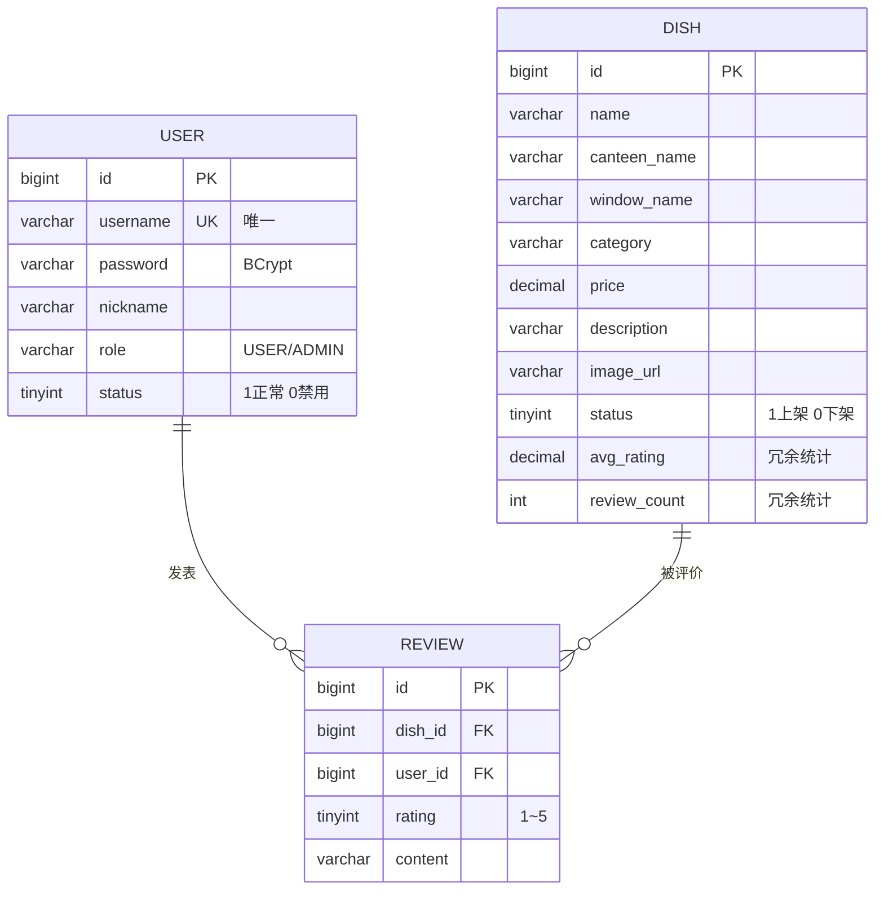

# 校园食堂菜品评价系统数据库设计文档

- **文档版本**：v1.1
- **编写日期**：2026-11-06
- **关联文档**：《校园食堂菜品评价系统-接口文档》v1.2
- **数据库**：MySQL 8.0（InnoDB，utf8mb4）
- **缓存 / 会话**：Redis（键统一使用 `canteen:` 前缀）
- **数据库名**：`restaurant`（建库脚本见仓库 `sql/schema.sql`）

---

## 1. 设计约定

| 约定项 | 说明 |
|---|---|
| 存储引擎 | InnoDB（支持事务、行锁） |
| 字符集 | utf8mb4，排序规则 `utf8mb4_0900_ai_ci`（支持 emoji） |
| 主键 | `BIGINT UNSIGNED AUTO_INCREMENT` |
| 命名 | 库、表、字段一律小写 snake_case；接口 JSON 的 camelCase 由 ORM 映射（如 MyBatis-Plus `map-underscore-to-camel-case`） |
| 时间 | 统一 `DATETIME`，`created_at` 默认当前时间，`updated_at` 自动更新；接口返回格式 `yyyy-MM-dd HH:mm:ss` 由后端格式化 |
| 金额 | `DECIMAL`，不使用 `FLOAT`/`DOUBLE`（避免精度问题） |
| 删除策略 | 菜品只做逻辑下架、账号只做启用/禁用（均使用 `status`），不物理删除；评价为物理删除（接口 DELETE 语义即删除） |
| 外键 | `review.dish_id`、`review.user_id` 建物理外键，采用默认 `RESTRICT` 删除策略；逻辑下架/禁用与物理外键不冲突，可保留历史数据并防止孤儿评价 |

---

## 2. ER 关系图



关系说明：

- 一个用户可以发表多条评价，一个菜品可以有多条评价；
- **一个用户对同一个菜品最多一条评价**，由 `review` 表的 `(dish_id, user_id)` 唯一索引保证（对应接口文档 5.1 的业务规则）；
- 菜品评分统计（`avg_rating`、`review_count`）冗余在 `dish` 表，避免每次列表查询都聚合 `review` 表。

---

## 3. 表结构设计

### 3.1 用户表 `user`

| 字段 | 类型 | 约束 | 说明 |
|---|---|---|---|
| id | BIGINT UNSIGNED | PK，自增 | 用户 ID（JWT `sub` 即此值） |
| username | VARCHAR(20) | NOT NULL，UNIQUE | 登录用户名，4～20 位字母、数字或下划线 |
| password | VARCHAR(60) | NOT NULL | BCrypt 加密后的密码（哈希固定 60 字符） |
| nickname | VARCHAR(20) | NOT NULL | 昵称，1～20 字符 |
| role | VARCHAR(10) | NOT NULL，默认 `USER`，CHECK | 角色：`USER` / `ADMIN` |
| status | TINYINT | NOT NULL，默认 1，CHECK 0～1 | 账号状态：1 正常 / 0 禁用（禁用后登录返回 403） |
| created_at | DATETIME | NOT NULL，默认当前时间 | 创建时间 |
| updated_at | DATETIME | NOT NULL，自动更新 | 更新时间 |

索引：

| 索引名 | 字段 | 类型 | 用途 |
|---|---|---|---|
| PRIMARY | id | 主键 | — |
| uk_username | username | 唯一索引 | 登录查找、注册查重 |

设计说明：

- 密码仅存 BCrypt 哈希，任何接口都不返回该字段；
- 注册接口创建的用户 `role` 固定为 `USER`，管理员通过初始化 SQL 或后台修改产生。

### 3.2 菜品表 `dish`

| 字段 | 类型 | 约束 | 说明 |
|---|---|---|---|
| id | BIGINT UNSIGNED | PK，自增 | 菜品 ID |
| name | VARCHAR(50) | NOT NULL | 菜品名称，1～50 字符 |
| canteen_name | VARCHAR(30) | NOT NULL | 食堂名称，1～30 字符 |
| window_name | VARCHAR(50) | NOT NULL | 窗口名称，1～50 字符 |
| category | VARCHAR(20) | NOT NULL | 菜品分类，1～20 字符 |
| price | DECIMAL(8,2) | NOT NULL，CHECK ≥ 0 | 价格（元），0～999999.99，最多两位小数 |
| description | VARCHAR(500) | NOT NULL，默认 `''` | 菜品介绍，最多 500 字符 |
| image_url | VARCHAR(255) | NOT NULL，默认 `''` | 图片地址，可为空字符串 |
| status | TINYINT | NOT NULL，默认 1，CHECK 0～1 | 上架状态：1 上架 / 0 下架（逻辑删除） |
| avg_rating | DECIMAL(2,1) | NOT NULL，默认 0.0，CHECK 0～5 | 平均评分，保留 1 位小数；无评价时为 0（冗余统计） |
| review_count | INT UNSIGNED | NOT NULL，默认 0 | 有效评价数量（冗余统计） |
| created_at | DATETIME | NOT NULL，默认当前时间 | 创建时间 |
| updated_at | DATETIME | NOT NULL，自动更新 | 更新时间 |

索引：

| 索引名 | 字段 | 类型 | 用途 |
|---|---|---|---|
| PRIMARY | id | 主键 | — |
| idx_status_created | (status, created_at, id) | 普通索引 | 公开列表“只查已上架 + 按创建时间、ID 倒序” |
| idx_status_count | (status, review_count, avg_rating) | 普通索引 | 按评价数量排序、热门榜 MySQL 兜底查询 |
| idx_canteen | canteen_name | 普通索引 | 按食堂筛选 |
| idx_category | category | 普通索引 | 按分类筛选 |

设计说明：

- 公开列表（`/dishes`）的 `avg_rating`、`review_count` 直接从本表读取，无需 JOIN 聚合；
- `sort=reviewCount` 和热门榜 MySQL 兜底查询使用 `(status, review_count, avg_rating)` 索引；所有排序最后追加 `id DESC`，保证同值时顺序稳定。
- `sort=rating` 在数据量小的情况下直接排序即可；数据量大时可追加 `(status, avg_rating, review_count)` 组合索引（见第 9 节）。
- `name` 模糊搜索为 `LIKE '%keyword%'`，无法走索引，课程项目规模下可接受；如需优化可引入全文索引（ngram）。

### 3.3 评价表 `review`

| 字段 | 类型 | 约束 | 说明 |
|---|---|---|---|
| id | BIGINT UNSIGNED | PK，自增 | 评价 ID |
| dish_id | BIGINT UNSIGNED | NOT NULL | 菜品 ID |
| user_id | BIGINT UNSIGNED | NOT NULL | 评价用户 ID |
| rating | TINYINT UNSIGNED | NOT NULL，CHECK 1～5 | 评分，1～5 的整数 |
| content | VARCHAR(500) | NOT NULL | 评价内容，去首尾空格后 2～500 字符 |
| created_at | DATETIME | NOT NULL，默认当前时间 | 创建时间 |
| updated_at | DATETIME | NOT NULL，自动更新 | 更新时间 |

索引：

| 索引名 | 字段 | 类型 | 用途 |
|---|---|---|---|
| PRIMARY | id | 主键 | — |
| uk_dish_user | (dish_id, user_id) | **唯一索引** | 保证一人一菜仅一条评价；并发重复评价的最终兜底（返回 409） |
| idx_user_created | (user_id, created_at, id) | 普通索引 | “我的评价”按用户过滤并按创建时间、ID 倒序分页 |
| idx_dish_created | (dish_id, created_at, id) | 普通索引 | 菜品评价按创建时间、ID 倒序分页 |

设计说明：

- `uk_dish_user` 已覆盖按 `dish_id` 的查询，`idx_dish_created` 额外支持分页排序；
- CHECK 约束需要 MySQL 8.0.16+；若使用 5.7 请删除 CHECK，由应用层校验 1～5；
- 评价删除为物理删除，删除后对应菜品的统计字段需重算（见第 5 节）。

---

## 4. 接口数据对象与表字段映射

| 接口文档对象 | 数据来源 | 说明 |
|---|---|---|
| `UserInfo` | `user` | id、username、nickname、role；`password` 永不返回 |
| `DishListItem` | `dish` | 只查 `status = 1`；`avgRating`/`reviewCount` 直接取冗余字段 |
| `DishDetail` | `dish` | 在 `DishListItem` 基础上增加 `description` |
| `ReviewItem` | `review` JOIN `user` | `nickname` 来自 `user` 表；`createdAt`/`updatedAt` 由 `created_at`/`updated_at` 格式化 |
| `MyReviewItem` | `review` JOIN `dish` | 在 `ReviewItem` 基础上增加 `dishName`（`dish.name`）、`canteenName`（`dish.canteen_name`） |

---

## 5. 数据一致性设计

### 5.1 冗余统计字段的维护

`dish.avg_rating`、`dish.review_count` 是冗余统计，**每次评价增、删、改后重算**（简单可靠，无需维护增量）：

```sql
UPDATE dish d
SET d.avg_rating = COALESCE(
        (SELECT ROUND(AVG(r.rating), 1)
         FROM review r
         WHERE r.dish_id = ?),
        0.0
    ),
    d.review_count = (
        SELECT COUNT(*)
        FROM review r
        WHERE r.dish_id = ?
    )
WHERE d.id = ?;
```

`AVG()` 在无记录时返回 `NULL`，因此必须使用 `COALESCE(..., 0.0)`；`COUNT()` 在无记录时返回 `0`。这样删除菜品最后一条评价后，统计值会正确恢复为 `0.0 / 0`。

### 5.2 事务边界

| 业务动作 | 事务内（MySQL） | 事务提交后（Redis） |
|---|---|---|
| 发表评价 | INSERT review + 重算 dish 统计 | 删除菜品详情缓存；按最新统计 `ZADD` |
| 修改评价 | UPDATE review + 重算 dish 统计 | 删除菜品详情缓存；上架菜品按最新统计 `ZADD`，下架菜品保持 `ZREM` |
| 删除评价 | DELETE review + 重算 dish 统计 | 删除菜品详情缓存；上架菜品按最新统计 `ZADD`，下架菜品保持 `ZREM` |
| 新增菜品 | INSERT dish | 上架时按当前统计 `ZADD`（通常为 0 分）；下架时不入榜 |
| 修改菜品 / 上、下架 | UPDATE dish | 删除菜品详情缓存；上架按当前统计 `ZADD`，下架执行 `ZREM` |

约定：

- 同一菜品的评价增、删、改事务，先通过 `SELECT id, status FROM dish WHERE id = ? FOR UPDATE` 锁定菜品行，再修改 `review` 并重算统计，避免并发事务写出过期统计。发表评价要求 `status = 1`；修改、删除历史评价允许菜品已下架。
- 菜品详情采用 **Cache-Aside 模式**：先提交数据库事务，成功后删除缓存；下一次查询回源重建。
- 热门榜以 MySQL 统计为准，不使用 `ZINCRBY ±1` 维护编码后的 score，而是根据最新统计重新 `ZADD`。
- Redis 操作失败不回滚已提交的 MySQL 事务，必须记录日志。详情缓存删除失败可由 TTL 兜底；热门榜写入或移除失败会造成脏数据，必须通过**定时全量校准 + 异常时 MySQL 回退查询**恢复，不能只依赖“榜单为空时重建”。

### 5.3 并发重复评价

- 应用层先查一次是否已评价（友好提示 409）；
- 数据库层由 `uk_dish_user` 唯一索引最终兜底：并发插入时捕获 `DuplicateKeyException`，同样返回 409（`你已经评价过该菜品，可以修改原评价`）。

### 5.4 逻辑下架

- 下架 = `UPDATE dish SET status = 0`，不删除数据，历史评价保留；
- 公开接口（列表、热门、详情、评价列表）统一加 `status = 1` 过滤；
- 下架后从热门榜 `ZREM`，再次上架时按当前统计重新 `ZADD`。

---

## 6. Redis 键设计

键统一使用 `canteen:` 前缀，与接口文档的 Session 设计保持一致。

### 6.1 登录会话（JWT 白名单）

| 项 | 值 |
|---|---|
| Key | `canteen:session:{jti}` |
| 类型 | String（JSON） |
| 内容 | `{"userId":1,"role":"USER","username":"student01","nickname":"小食同学"}` |
| TTL | 7200 秒（与 JWT 过期时间一致） |
| 写入 | 登录成功时 SET |
| 删除 | 退出登录时 DEL；JWT 校验时若 key 不存在则视为未登录（401） |

### 6.2 菜品详情缓存

| 项 | 值 |
|---|---|
| Key | `canteen:dish:detail:{dishId}` |
| 类型 | String（JSON，`DishDetail` 完整结构） |
| TTL | 建议 1800 秒（可调） |
| 失效时机 | 该菜品评价增/删/改（评分统计变化）、菜品修改、上/下架 |

### 6.3 热门菜品榜

| 项 | 值 |
|---|---|
| Key | `canteen:hot:dishes` |
| 类型 | ZSET（有序集合） |
| member | 菜品 ID |
| score | `review_count × 100 + round(avg_rating × 10)` |

score 编码公式说明：

- 排行规则是"评价数量降序，数量相同时按平均评分降序"（接口文档 4.2）；
- 平均评分部分 `round(avg_rating × 10)` 取值为 0～50，恒小于 100，不会进位干扰评价数部分，因此按 score 降序恰好等价于该排序规则；
- 例如：18 条评价、4.5 分 → `18×100 + 45 = 1845`；17 条评价、5.0 分 → `17×100 + 50 = 1750`，前者排前面 ✓。

操作方式：

| 业务动作 | Redis 操作 |
|---|---|
| 发表评价（事务提交后） | 新评价只能属于上架菜品，按最新统计 `ZADD` 覆盖写入 |
| 修改 / 删除历史评价 | 先确认菜品状态：上架则按最新统计 `ZADD`；下架则保持 `ZREM`，不得重新入榜 |
| 新增菜品 | 上架时按当前统计 `ZADD`（通常为 0 分）；下架时不入榜 |
| 下架 | `ZREM` |
| 上架 | 按当前统计 `ZADD` |
| 查询 | `ZREVRANGE canteen:hot:dishes 0 {limit-1}` 取得菜品 ID，再批量查询 MySQL 中 `status = 1` 的菜品，并按 ID 列表顺序组装返回；发现 ID 已失效或结果异常时回退 MySQL 并触发重建 |

任何 `ZADD` 写入前，如果热门榜 key 不存在，必须先根据 MySQL 全量初始化，再执行写入，避免用一个菜品创建出不完整的榜单。

兜底与校准：

1. Redis 查询异常、榜单 ID 与菜品状态不一致时，直接回退 MySQL：`SELECT * FROM dish WHERE status = 1 ORDER BY review_count DESC, avg_rating DESC LIMIT ?`，由 `idx_status_count` 支持。
2. 榜单 key 不存在时，根据 `dish` 表全部 `status = 1` 的记录懒重建，零评价菜品也包含在内。
3. 通过定时任务按 MySQL 全量重建或校准榜单，修复 `ZADD` / `ZREM` 失败造成的“key 存在但内容过期”问题；不能仅依靠空 key 检测。

---

## 7. 建表 SQL

```sql
-- ============================================================
-- 校园食堂菜品评价系统 数据库初始化脚本
-- 数据库：MySQL 8.0+（InnoDB / utf8mb4）
-- 注意：CHECK 约束需要 MySQL 8.0.16+，5.7 请删除 CHECK 由应用层校验
-- ============================================================

CREATE DATABASE IF NOT EXISTS restaurant
  DEFAULT CHARACTER SET utf8mb4
  COLLATE utf8mb4_0900_ai_ci;

USE restaurant;

-- ---------- 用户表 ----------
CREATE TABLE `user` (
  `id`         BIGINT UNSIGNED NOT NULL AUTO_INCREMENT COMMENT '用户ID',
  `username`   VARCHAR(20)     NOT NULL                COMMENT '登录用户名（4~20位字母数字下划线）',
  `password`   VARCHAR(60)     NOT NULL                COMMENT 'BCrypt加密后的密码（固定60字符）',
  `nickname`   VARCHAR(20)     NOT NULL                COMMENT '昵称（1~20字符）',
  `role`       VARCHAR(10)     NOT NULL DEFAULT 'USER' COMMENT '角色：USER-普通用户 / ADMIN-管理员',
  `status`     TINYINT         NOT NULL DEFAULT 1      COMMENT '账号状态：1-正常 / 0-禁用',
  `created_at` DATETIME        NOT NULL DEFAULT CURRENT_TIMESTAMP COMMENT '创建时间',
  `updated_at` DATETIME        NOT NULL DEFAULT CURRENT_TIMESTAMP
                               ON UPDATE CURRENT_TIMESTAMP COMMENT '更新时间',
  PRIMARY KEY (`id`),
  UNIQUE KEY `uk_username` (`username`),
  CONSTRAINT `chk_user_role` CHECK (`role` IN ('USER', 'ADMIN')),
  CONSTRAINT `chk_user_status` CHECK (`status` IN (0, 1))
) ENGINE=InnoDB DEFAULT CHARSET=utf8mb4 COLLATE=utf8mb4_0900_ai_ci COMMENT='用户表';

-- ---------- 菜品表 ----------
CREATE TABLE `dish` (
  `id`           BIGINT UNSIGNED NOT NULL AUTO_INCREMENT COMMENT '菜品ID',
  `name`         VARCHAR(50)     NOT NULL                COMMENT '菜品名称（1~50字符）',
  `canteen_name` VARCHAR(30)     NOT NULL                COMMENT '食堂名称（1~30字符）',
  `window_name`  VARCHAR(50)     NOT NULL                COMMENT '窗口名称（1~50字符）',
  `category`     VARCHAR(20)     NOT NULL                COMMENT '菜品分类（1~20字符）',
  `price`        DECIMAL(8,2)    NOT NULL                COMMENT '价格（元），0~999999.99',
  `description`  VARCHAR(500)    NOT NULL DEFAULT ''     COMMENT '菜品介绍（最多500字符）',
  `image_url`    VARCHAR(255)    NOT NULL DEFAULT ''     COMMENT '图片地址（最多255字符）',
  `status`       TINYINT         NOT NULL DEFAULT 1      COMMENT '上架状态：1-上架 / 0-下架（逻辑删除）',
  `avg_rating`   DECIMAL(2,1)    NOT NULL DEFAULT 0.0    COMMENT '平均评分（1位小数，无评价为0）',
  `review_count` INT UNSIGNED    NOT NULL DEFAULT 0      COMMENT '有效评价数量',
  `created_at`   DATETIME        NOT NULL DEFAULT CURRENT_TIMESTAMP COMMENT '创建时间',
  `updated_at`   DATETIME        NOT NULL DEFAULT CURRENT_TIMESTAMP
                                 ON UPDATE CURRENT_TIMESTAMP COMMENT '更新时间',
  PRIMARY KEY (`id`),
  KEY `idx_status_created` (`status`, `created_at`, `id`),
  KEY `idx_status_count` (`status`, `review_count`, `avg_rating`),
  KEY `idx_canteen` (`canteen_name`),
  KEY `idx_category` (`category`),
  CONSTRAINT `chk_dish_price` CHECK (`price` >= 0),
  CONSTRAINT `chk_dish_status` CHECK (`status` IN (0, 1)),
  CONSTRAINT `chk_dish_avg_rating` CHECK (`avg_rating` BETWEEN 0 AND 5)
) ENGINE=InnoDB DEFAULT CHARSET=utf8mb4 COLLATE=utf8mb4_0900_ai_ci COMMENT='菜品表';

-- ---------- 评价表 ----------
CREATE TABLE `review` (
  `id`         BIGINT UNSIGNED  NOT NULL AUTO_INCREMENT COMMENT '评价ID',
  `dish_id`    BIGINT UNSIGNED  NOT NULL                COMMENT '菜品ID',
  `user_id`    BIGINT UNSIGNED  NOT NULL                COMMENT '评价用户ID',
  `rating`     TINYINT UNSIGNED NOT NULL                COMMENT '评分（1~5的整数）',
  `content`    VARCHAR(500)     NOT NULL                COMMENT '评价内容（去首尾空格后2~500字符）',
  `created_at` DATETIME         NOT NULL DEFAULT CURRENT_TIMESTAMP COMMENT '创建时间',
  `updated_at` DATETIME         NOT NULL DEFAULT CURRENT_TIMESTAMP
                                ON UPDATE CURRENT_TIMESTAMP COMMENT '更新时间',
  PRIMARY KEY (`id`),
  UNIQUE KEY `uk_dish_user` (`dish_id`, `user_id`),
  KEY `idx_user_created` (`user_id`, `created_at`, `id`),
  KEY `idx_dish_created` (`dish_id`, `created_at`, `id`),
  CONSTRAINT `chk_rating` CHECK (`rating` BETWEEN 1 AND 5),
  CONSTRAINT `fk_review_dish` FOREIGN KEY (`dish_id`) REFERENCES `dish` (`id`) ON DELETE RESTRICT,
  CONSTRAINT `fk_review_user` FOREIGN KEY (`user_id`) REFERENCES `user` (`id`) ON DELETE RESTRICT
) ENGINE=InnoDB DEFAULT CHARSET=utf8mb4 COLLATE=utf8mb4_0900_ai_ci COMMENT='评价表';
```

---

## 8. 初始化数据

```sql
-- ============================================================
-- 初始化数据（演示用）
-- 三个账号的密码均为 123456（哈希为真实 BCrypt 值，生产环境请更换）
-- ============================================================

INSERT INTO `user` (`id`, `username`, `password`, `nickname`, `role`, `status`) VALUES
(1, 'admin',     '$2b$10$Y/zI2Wj41kMwM7Ql0vRjkuOeM9l0jozRGjJsOlJpVtBOkxPk3tm7S', '管理员',   'ADMIN', 1),
(2, 'student01', '$2b$10$Y/zI2Wj41kMwM7Ql0vRjkuOeM9l0jozRGjJsOlJpVtBOkxPk3tm7S', '小食同学', 'USER',  1),
(3, 'ganfanren', '$2b$10$Y/zI2Wj41kMwM7Ql0vRjkuOeM9l0jozRGjJsOlJpVtBOkxPk3tm7S', '干饭人',   'USER',  1);

INSERT INTO `dish`
(`id`, `name`, `canteen_name`, `window_name`, `category`, `price`, `description`, `image_url`, `status`, `avg_rating`, `review_count`) VALUES
(1, '番茄鸡蛋面',  '第一食堂', '3号窗口', '面食',     12.00, '番茄汤底，搭配鸡蛋和青菜',          '', 1, 4.5, 2),
(2, '牛肉拉面',    '第一食堂', '1号窗口', '面食',     13.00, '清汤牛肉拉面，可加辣',              '', 1, 4.0, 1),
(3, '宫保鸡丁盖饭', '第二食堂', '5号窗口', '盖饭',     15.00, '经典川味宫保鸡丁',                  '', 1, 0.0, 0),
(4, '黄焖鸡米饭',  '第三食堂', '2号窗口', '米饭套餐', 16.00, '砂锅黄焖鸡配米饭',                  '', 1, 0.0, 0),
(5, '麻辣香锅',    '第二食堂', '6号窗口', '特色',     18.00, '自选食材，微辣中辣特辣可选',         '', 1, 0.0, 0);

-- 示例评价（与上面 dish 的统计值一致：1号菜 4.5 分 2 条，2号菜 4.0 分 1 条）
INSERT INTO `review` (`dish_id`, `user_id`, `rating`, `content`) VALUES
(1, 2, 5, '份量很足，番茄汤味道不错。'),
(1, 3, 4, '味道可以，就是饭点排队有点久。'),
(2, 3, 4, '牛肉片给得挺多，汤底清爽。');
```

补充：管理员账号也可以先用注册接口创建普通账号，再执行 `UPDATE user SET role = 'ADMIN' WHERE username = 'xxx';` 升级。

---

## 9. 性能与扩展说明

1. **排序优化**：`sort=reviewCount` 和热门榜 MySQL 兜底查询使用已创建的 `idx_status_count (status, review_count, avg_rating)`；`sort=rating` 在数据量增大后可按需增加 `KEY idx_status_rating (status, avg_rating, review_count)`。所有分页排序追加 `id DESC` 作为同值兜底。
2. **菜品详情缓存**：详情接口命中 Redis 缓存后不再查询数据库；缓存被删除后下次访问回源重建。
3. **分类字典化（可选）**：`category` 目前为自由字符串；若需统一管理分类，可拆出 `category` 字典表，`dish.category` 改为外键 ID，前端筛选项由字典表提供。
4. **图片存储**：`image_url` 目前存外部链接；若支持本地上传，需补充文件存储方案（本地静态目录 + 静态资源映射，或 OSS），表结构不变。
5. **若改用 PostgreSQL**：`BIGINT UNSIGNED AUTO_INCREMENT` 改为 `BIGSERIAL`，`DATETIME` 改为 `TIMESTAMP`，`TINYINT` 改为 `SMALLINT`，DECIMAL、CHECK、唯一索引语法基本一致，Redis 设计不受影响。
6. **热门榜规则扩展**：score 编码公式已预留评分 tie-break，若未来排行规则变化，只需调整 score 计算并在重建时全量刷新。
